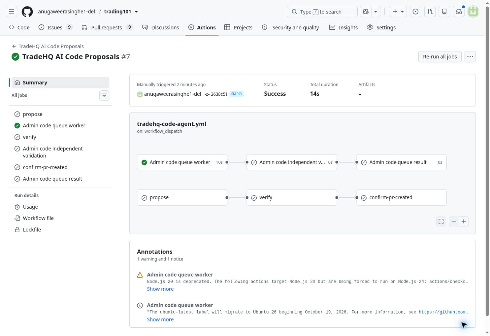

# Native code-worker check-ins and interrupted-result recovery

Every successful queue claim connection now records its native run, exact main
SHA, server timestamps and idle/claimed status. Request completion and validation
update the same worker row. The owner admin desk displays these check-ins with
links to the original native logs. Failures before the connection remain in
GitHub logs; this list does not claim to capture work that never reached the API.

Before claiming new work, the server checks unresolved proposals. It independently
reads the original stored native run and first-attempt validation job. The stored
repository, workflow and base SHA must match; the original run and validation
must have completed. The server then settles the original exact-head request,
updates validation memory and appends `NATIVE_RESULT_RECONCILED` atomically.
Concurrent/later connections cannot add another result or re-execute the request.
This repairs interrupted queue bookkeeping, not website source or a production
incident. Provider calls, consumed attempts and production release rules are
unchanged. Canceled/skipped/timed-out results unblock the queue without becoming
negative training labels. GitHub's `cancelled` spelling is normalized internally.

Offline evidence covers actual SQL and handler recovery of a lost result,
wrong-base rejection, unfinished-run deferral, one result/event under replay,
idle check-ins and canceled-result exclusion. Native PostgreSQL checks concurrent
worker claims and their durable check-ins. Compiled Chromium checks admin display.
These fixtures are not operational repairs and earn no rubric point.

Prior released integration evidence:

- Queue PR #165: main `2638c51c3043a95e3534572a1ffa699f2d6e06ae`.
- Real native idle handshake: run 38886251817, job116924598476, success at
  2026-10-16T10:17:43Z, zero model calls and no queued request.
- Learning PR #166: main `839d0de87c8834de9aeedfba4db81e32a2571f41`;
  required CI38886560844, PostgreSQL38886560927 and monitor38886560925 passed.
- Native release witness job116926666940 confirmed Cloudflare canonical
  production/main/success `acdef00f-539f-473a-856b-5171caadbb66` at that SHA.
  Vercel production `dpl_J4A3Qhqa4wChs75hvSzEBAEPjhh8` was independently READY.
- Production learning starts with zero real outcomes and explicitly collects
  evidence. No synthetic request/outcome was inserted in production.

The original rubric remains 33/42. No learning/check-in/merge point is invented.
Daily's separately authorized one-shot is still scheduled for 21:46 Sri Lanka
16 October, after its cooldown, with an outcome check at 21:49; no generation
success or publication is claimed before that actual result and editorial review.
